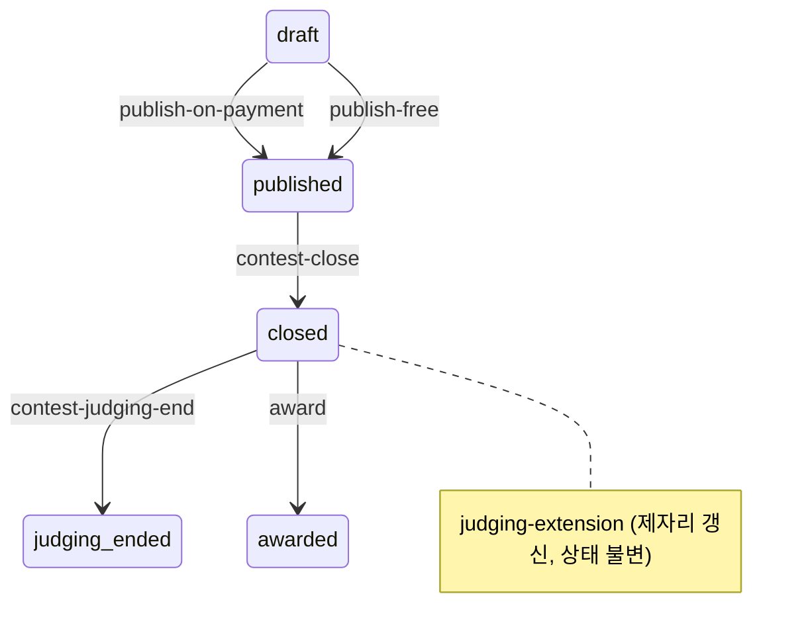

# 백엔드 기능 명세

**현재형 문서다** — [`README.md`](README.md) 의 갱신 규율을 먼저 읽는다.

Django + django-ninja. 하나의 `NinjaAPI` 에 라우터를 붙여 `/api` 아래로 낸다
(`backend/config/api.py`). **HTTP 가 유일한 시임이다** — 테스트도 이 스택을 통과해 들어온다.

## 표면이 여섯이다

경로 접두어가 곧 「누가 부르는가」다. 인증 방식도, 실패했을 때 무엇이 막히는지도 다르다.

| 표면 | 접두어 | 누가 부르는가 | 인증 |
| --- | --- | --- | --- |
| 공개·참가자 | `/api/…` | 브라우저(공개 앱의 BFF 경유) | JWT(HttpOnly 쿠키에서 BFF 가 꺼내 헤더로) |
| 운영자 | `/api/operator/…` | 운영자 앱 | Django 세션 쿠키 + Origin 검증 미들웨어 |
| 내부 | `/api/internal/…` | Celery beat·운영자의 수동 tick | `X-Internal-Token` |
| 스토리지 | `/api/storage/…` | 브라우저(업로드·다운로드 URL 발급) | JWT |
| 연결된 앱 | `/api/classroom/mcp` · `/api/classroom/oauth/{metadata/*,register,token,revoke}` | 외부 AI 앱(강의실 앱이 `/mcp`·`/.well-known/oauth-*`·`/oauth/*` 를 넘긴다) | MCP 는 OAuth 접근 토큰(Bearer), 메타데이터·등록은 없음, 토큰·회수는 OAuth 클라이언트 인증 |
| 지표 | `/metrics` | oracle 의 감시 스택(Prometheus, compose 네트워크 안에서 `backend:8000`) | 없음 — Host 가 내부 서비스 이름일 때만 답하고 나머지는 404 |

**운영자 표면은 기본 거부다.** 라우터 자체가 거부로 시작하고 Origin 검증이 경로 접두어로
걸린다. 그 오리진이 어긋나면 로그인을 포함한 모든 운영자 변경 요청이 조용히 403 이 된다 —
fail-closed 라 구멍은 아니지만 원인을 찾기 어렵다.

**내부 표면과 운영자 표면은 다른 것이다.** 내부는 사람이 판단하지 않는 자동 스캔 전용이고,
사람이 판단하는 행위는 전부 운영자 표면에서 신원과 함께 이루어진다(ADR-0019).

## 무엇을 받는가 — 참가자·발주자 표면

### 계정과 신원

| | |
| --- | --- |
| `POST /api/auth/social/{provider}/login` | 소셜 로그인 — 토큰 쌍을 발급한다 |
| `POST /api/auth/refresh` · `POST /api/auth/logout` | 갱신·블랙리스트 |
| `GET /api/accounts/me` | 나 |
| `POST /api/accounts/developer-profile` · `sponsor-profile` | 역할 프로필을 만든다(멱등) |
| `GET`·`POST /api/accounts/withdrawal` | 탈퇴 가능 여부와 탈퇴 실행 |

**두 프로필의 `display_name`(개최자 공개용 이름·개발자 표시 이름, CONTEXT.md
「이름」)에 금칙어(사칭·욕설)가 있으면 422 로 거절한다**(spec #474, #478) —
둘 다 로그인 없이 열리는 화면(공개 공모전 목록·상세, 공개 개발자 프로필)에
뜨기 때문이다. `POST` 가 생성과 수정을 겸하므로 처음 정할 때도, 나중에
사칭으로 바꾸려 할 때도 같은 검사를 받는다. **`bio`(소개글)는 욕설만
본다**(spec #474, #480) — 이름이 아니라 `display_name`과 같은 화면에 뜨는
공개 본문이라 「제 직업은 관리자입니다」 같은 문장이 막히면 안 되기
때문이다. 어느 필드가 검사 대상인지는 `backend/core/banned_word_rules.py`
표에 있다 — 그 표가 규칙 표와 어긋나지 않는지는 `tests/
test_banned_word_field_registration.py`(#480)가 매 커밋 확인한다.

**계정을 가리키는 것은 소셜 계정 `(제공자, 제공자 식별자)` 하나다**(ADR-0049,
CONTEXT.md 「소셜 계정」). 이메일은 로그인에서 사람을 찾는 데 쓰지 않는다 — 없을
수도 있고 주인이 바뀔 수도 있다. 대신 **로그인마다** 이메일과 「제공자가 인증했다고
말했는가」를 최신값으로 갱신한다(닉네임과 같은 자리). 그 이메일이 하는 일은 둘이다:

- **사람을 찾고 보이는 단서** — 운영자 표면(운영팀 알림의 계정 검색·발송 이력)에서만
  보인다. 참가자·강사 화면에는 나오지 않는다.
- **계정 연결** — 제공자가 **인증한** 이메일이 같으면 새 소셜 계정을 기존 계정에 붙여
  어느 쪽으로 로그인해도 같은 사람이 된다. 인증되지 않았거나 걸리는 계정이 하나가
  아니면 묶지 않는다. 묶인 사실은 `AccountLink`(append-only)에 언제·어떤 이메일을
  근거로 붙었는지 남는다.

**비어 있지 않은 계정 이메일은 유일하다**(부분 유일 인덱스). 다른 계정이 이미 그
이메일을 쓰고 있고 연결 조건도 아니면 **이메일 칸을 비운 채 로그인은 그대로 된다** —
이메일이 없다고 로그인을 막지 않는다는 것이 유일 제약보다 앞선다. **탈퇴는 이메일·
닉네임도 파기한다**(ADR-0025 의 같은 선) — 제공자 식별자는 남겨 같은 소셜 계정으로
다시 로그인하는 길을 계속 막는다.
| `POST /api/verification/start` · `verify` | 본인확인 시작·확정 |
| `GET /api/verification/me` | 내 본인확인 상태 |
| `POST /api/verification/lookup-by-ci` | CI 로 조회 |

**본인확인은 행위 시점에 요구한다**(ADR-0011) — 가입할 때가 아니라 개최·제출처럼 돈이나
책임이 걸리는 순간이다. 성인만 통과한다. **무료 공모전(#415/#416, ADR-0048)은 예외다** —
개최에는 개최 권한이, 제출에는 소스 열람 동의(`source_access_consent`)가 그 자리를
대신한다. 돈이 걸리지 않으므로 본인확인 자체가 없다.

**신원은 파기되어도 계정은 남는다**(ADR-0025). 탈퇴는 신원 정보를 지우고 상태를
`withdrawn` 으로 내리며, 2년 미이용 계정은 스캔이 `expired` 로 내린다 — 계정은 살아 있고
로그인도 되며, 다음에 개최·제출을 시도할 때 본인확인을 다시 요구받는다.

### 공모전

| | |
| --- | --- |
| `GET /api/contests` | 공개 목록 — 참가 가능한 것이 기본, `closed=1` 로 마감된 것, `q` 로 검색(#449) |
| `GET /api/contests/home` | 홈 큐레이션 |
| `GET /api/contests/{id}` | 상세 — 로그인 없이 열린다 |
| `POST /api/contests` | 개최(유료) |
| `PATCH /api/contests/{id}` | 브리프 수정 — DRAFT는 결제 전까지, PUBLISHED는 마감 전까지(제출을 받는 동안, #473, ADR-0051). 마감 뒤(CLOSED 이후)는 409 |
| `POST /api/contests/quote` | 개최 견적(유료) |
| `GET /api/contests/free/hosting-permission` | 내 무료 공모전 개최 권한(#415) |
| `POST /api/contests/free` | 무료 개최(#415) — 본인확인·결제 없이, 개최 권한만 |
| `POST /api/contests/{id}/publish` | 무료 공모전 공개(#415) — 결제 대신 개최 권한이 연다, 요구사항이 없거나 개최자 표시 이름이 없으면 422(#447) |
| `GET /api/contests/mine` | 내가 연 것 |
| `POST`·`PATCH`·`DELETE .../requirements[/{id}]` | 요구사항 — `PATCH /contests/{id}`와 같은 문(DRAFT·PUBLISHED, #473). 문구(`text`)는 공개 제목·설명과 같은 노출이라 욕설이면 422다(spec #474, #480) — 상세 화면에서 로그인 없이 보인다 |
| `.../requirement-chat/messages` | 요구사항을 LLM 과 함께 다듬는다 — 새 턴 보내기는 DRAFT뿐, 대화 이력 읽기는 상태 무관 |
| `POST .../images/upload-url` · `images` · `PATCH`·`DELETE .../images/{id}` | 이미지 — DRAFT뿐(#473 이후에도 넓히지 않았다) |
| `POST .../views` | 조회 기록 |
| `GET .../metrics` | 개최자용 지표 |
| `POST .../reopen` | 재개최 |
| `POST .../extend-judging-period[/{order}/confirm]` | 심사기간 연장(유료) |
| `GET .../submissions/compare` | 제출작 비교 |
| `POST .../award` | 선정 |
| `GET`·`POST .../handover[/accept]` | 인수 |
| `GET`·`POST .../payout` | 지급 |

**Contest 는 하나의 엔티티다**(ADR-0001). 과제(Assignment)를 같은 표에 함께
나르던 `kind` 필드(ADR-0033)는 과제가 접히며(#358, ADR-0044) 스키마에서도
걷혔다.

**공모전 제품 스위치는 「공모전 / 유료 공모전」 둘이다**(`settings.
CONTEST_PRODUCT_ENABLED`·`PAID_CONTEST_PRODUCT_ENABLED`, `core.contest_switch`,
ADR-0048). 공모전 스위치가 꺼지면 위 표의 `contests.api` 소관 표면 전체(목록·
상세·홈·수정·요구사항·AI grill·이미지·조회 기록·무료 개최·공개와, 아래 유료
스위치가 닫는 것 전부)가 404다. 유료 스위치만(공모전은 켜진 채) 꺼지면
견적·본인확인이 필요한 개최·재개최·심사기간 연장이 404다 — 무료 개최
(`POST /api/contests/free`)·공개(`POST /api/contests/{id}/publish`, #415)는
공모전 스위치만 보므로 유료 스위치가 꺼져도 그대로 열려 있다. `GET
/api/contests/categories`·
`deliverable-types`(주소만으로는 다른 소관과 갈리지 않아 예외로 열어 둔다)와,
`award`·`handover`·`payout`·`metrics`·`submissions/compare`(각각 awards·
handovers·payouts·submissions 앱 소관 — 이미 존재하는 공모전을 마무리하는
표면이라 두 스위치와 무관하게 열려 있다)는 예외다. 기본은 둘 다 켜짐이고
staging·prod 배포만 유료 스위치를 끈다(`CLAUDE.md` 「배포」). 닫히는 표면의
전체 목록은 `core.contest_switch` 모듈 docstring 이 든다.

**제출을 받는 동안(published)에도 브리프·요구사항을 고칠 수 있다**(#473,
ADR-0051). 예전에는 공개하는 순간 통째로 잠겼다. 지금은 마감(closed 이후)이
그 문이다 — Score가 마감 직후 한 번만 만들어지는 불변 스냅샷이라서다
(ADR-0006). `prize`는 이 문이 열어주는 대상이 아니다(PUBLISHED에서 오면
422) — 이미 결제·Escrow가 확정한 금액이고, 요구형태가 바뀌어도 개최 시점에
굳은 `required_minimum_prize`·`is_underfunded` 스냅샷은 다시 계산하지 않는다.
AI grill 대화(새 턴 보내기)와 이미지 CRUD는 그대로 DRAFT뿐이다. PUBLISHED에서
실제로 바뀐 필드가 있으면 `ContestChange`(누가·언제·무엇을 남기는 이력,
DeliverableTypeChange와 같은 규율)가 남고 이미 제출한 참가자 전원에게
`NotificationType.CONTEST_UPDATED` 알림이 간다 — 「알림」절 참고.

### 제출

| | |
| --- | --- |
| `POST /api/contests/{id}/submissions` | 제출 |
| `GET`·`PUT /api/contests/{id}/submissions/me` | 내 제출 조회·수정 |
| `GET /api/submissions/mine` | 내 참가 현황 |
| `GET /api/submissions/{id}` | 제출물 하나 |
| `GET /api/submissions/{id}/score` | 내 점수 |
| `GET`·`POST /api/submissions/{id}/appeal` | 이의 |
| `GET`·`POST /api/submissions/{id}/build-assets` | 인수용 빌드 산출물 |
| `GET .../source-readings` | 내 소스를 누가 열람했는가 |

**무료 공모전 제출은 본인확인 대신 소스 열람 동의를 요구한다**(#416, ADR-0048).
`contest.is_free`면 `POST`·`PUT .../submissions[/me]`가 본인확인·자전거래 검사를
건너뛰고 대신 `SubmissionIn.source_access_consent`를 확인한다 — 없으면(또는
false면) 422다. 동의마다 `ContestSubmission.source_access_consent_at`(제출·
수정 때마다 다시 찍는다)을 남기고 `SubmissionOut`에 그대로 싣는다. 유료
공모전은 이 필드를 무시한다(그 대신 본인확인이 있다).

**제출물은 자료를 여럿 갖는다**(ADR-0027) — 소스·저장소·시연 영상·스크린샷·데모 URL(#264,
ADR-0036). 업로드 자료의 값은 `submission:{공모전id}:{개발자id}:{슬롯}/…` 로 시작해야
한다. 그 접두어가 「이 파일이 누구의 어느 제출에 속하는가」를 값 자체에 박아 남의 오브젝트를
자기 제출에 붙이지 못하게 한다. **스크린샷은 파일이 사는 버킷·마감 규칙이 시연 영상과
같다**(마감 전 비공개, 마감 후 전면 공개) — 다만 채점 입력(#191 의 LLM 컨텍스트 예산)에는
들어가지 않는다. AI 채점은 텍스트 프롬프트만 읽어 이미지를 보지 못하기 때문이다. 업로드
시점에 MIME 허용목록(png·jpeg·webp·gif, `ContestImage` 와 같다)이 이미지가 아닌 파일을
거절한다.

**「지금 무엇을 해야 하는가」는 서버가 판단한다.** `next_action` 하나가 **15개 값** 중
하나로 답한다 — 기다리는 것(채점 대기 · 심사 대기 · 이의 심판 대기 · 배분 대기 · 인수 확인
대기 · 지급대행 등록 대기 · 지급 처리 확인 중), 네 차례인 것(제출물 수정 가능 · 이의 제기
가능 · 재확인 필요 · 지급 요청 · 세무 신원 제출 · 실이체 재시도), 끝난 것(미선정 · 지급
완료). 값이 enum 이라 하나 늘면 생성된 TS 타입에도 늘고 `tsc --noEmit` 이
프론트의 누락된 분기를 빌드타임에 잡는다.

**「마감 대기」는 없다.** 예전에 있었고 지웠다 — 마감 전에는 기다리는 것 말고도 할 일이
있기 때문이다(자료와 체크리스트를 고치는 것). 지금 그 자리는 「제출물 수정 가능」이다.

**그 값은 행위 엔드포인트의 전제와 같은 조건에서 나와야 한다.** 조건을 두 벌로 쓰면
언젠가 갈라지고, 그때 화면은 시키는 대로 한 사용자에게 403 을 보여준다.

### 돈

| | |
| --- | --- |
| `POST /api/payments` · `/{order}/confirm` · `/webhook` | 결제 |
| `POST /api/payouts/{key}/confirm` | 지급 확정 |
| `POST /api/payouts/{key}/identity` · `seller-contact` · `seller-registration` | 지급대행 등록 |
| `POST /api/payouts/webhook[/toss|/toss-seller]` | 웹훅 |
| `GET /api/ledger/contests/{id}/balance` · `entries` | 원장 |

**유료 공모전 스위치가 꺼지면 `POST /api/payments`·`/{order}/confirm`이 404다**
— 이 스위치가 공모전 쪽 새 결제를 막는다. `/webhook`은 닫지 않는다(PG가 서버 대
서버로 부른다) — 새 REQUESTED Payment 자체가 안 생기므로 사실상 부를 일이
없어진다. 지급·원장은 그대로 연다 — 이미 확정된 지급을 마무리하는 표면이다.

**`POST /api/payments`도 개최자 표시 이름이 없으면 422다**(#447) — 결제로
공개되는 경로라 PG 등록 전에 여기서 막는다. 무료 공개와 같은 조건
(`accounts.sponsor_display.require_sponsor_display_name`)이고, 초안
생성·수정에는 요구하지 않는다.

**복식부기 원장이 진실이다**(ADR-0004). 계정은 다섯이다 — 발주자 예치금 · 개발자 미지급금 ·
플랫폼 수수료 수익 · 원천징수 예수금 · PG 수수료 비용. 분개는 **append-only** 이고, 배포
환경에서는 삭제 자체가 거부된다.

**지급대행 등록은 지급 확정 뒤에 일어난다**(ADR-0020) — 순서가 반대면 아직 받을지도 모르는
사람에게 판매자 등록을 요구하게 된다. 신원은 토스가, 세무는 Codemit 가 맡는다(ADR-0008).

**무료 공모전은 이 절 전체를 건드리지 않는다**(#417, ADR-0048). `awards.api.
award_submission`이 무료 공모전이면 `Award`만 만들고 `Handover`를 만들지 않는다 —
Escrow 해제·지급 절차 자체가 없다. 그 결과 `POST/GET .../handover[/accept]`·
`POST/GET .../payout`이 그 공모전에 대해 자연스럽게 404다("이 공모전은 아직
선정되지 않아 인수 정보가 없습니다" — Handover 행이 없다는 사실 그대로다).
심사기간이 무응답으로 끝나도 `distributions.services.distribution_due_q`가
`is_free=False`를 조건에 넣어 `Distribution`을 만들지 않는다 — 나눠 줄 돈이
없다. 이의제기(`POST /submissions/{id}/appeal`)도 무료 공모전이면 404다.
유료 심사기간 연장(`.../extend-judging-period`)도 유료 스위치가 켜져 있어도
무료 공모전 자신에 대해서는 409다. 수상자 알림(`notify_award_result`)만은
유료·무료 구분 없이 그대로 보낸다.

### 강의실

`/api/classroom` 아래다(ADR-0037) — 공모전 가족과는 앱 경계가 양방향으로 막혀 있다
(`tests/test_app_boundaries.py`). 상금도 결제도 본인확인도 마감도 없다.

| | |
| --- | --- |
| `POST`·`GET /api/classroom/classes[/{id}]` | 클래스를 열고 내 것만 본다 |
| `GET /api/classroom/classes/joined` | 참여자로 들어간 클래스 — 본인이 강사인 클래스는 여기 겹쳐 나오지 않는다(#328) |
| `PATCH /api/classroom/classes/{id}` | 이름·기본 채점 모델·기본 추론 강도를 고친다(#402) |
| `PUT /api/classroom/classes/{id}/openai-key` | 강사 본인의 채점 키를 저장한다 — 마스킹된 값만 돌려준다(#284) |
| `GET /api/classroom/classes/{id}/scoring-models` | 그 클래스의 키로 실제로 쓸 수 있는 채점 모델·컨텍스트 크기·추론 모델 여부(#401, 예전 전역 `/scoring-models`를 대신한다) |
| `POST /api/classroom/classes/{id}/join-link/regenerate` | 가입 링크를 다시 뽑는다 — 이전 코드는 죽는다(#279) |
| `POST .../archive`·`.../unarchive` | 클래스를 보관하고 되돌린다 — 지우지 않는다(#294) |
| `DELETE /api/classroom/classes/{id}` | 클래스를 지운다 — 어느 문제에도 제출이 없을 때만, 되돌릴 수 없다(#330) |
| `GET`·`POST /api/classroom/join/{code}` | 가입 링크 미리보기(인증 불필요)와 가입(#280) |
| `GET /api/classroom/classes/{id}/members` | 참여자 명단 — 강사 전용(#281) |
| `POST .../members/{id}/expel` | 참여자를 내보낸다 — 행은 지우지 않는다(#281) |
| `GET .../roster-grid` | 참여자 × 문제 격자 — 셀마다 통과 이력, 달성률 행은 `problems` 목록과 같은 계산을 재사용한다(#290) |
| `POST`·`GET /api/classroom/classes/{id}/problems[/{id}]` | 문제를 만들고 고친다 — 마감 필드가 없다, 채점 지침(#386)도 함께 받는다 |
| `PATCH .../problems/{id}` | 제목·설명·제출 형식·채점 모델·추론 강도(#402)·채점 지침(#386)을 고친다 |
| `POST .../problems/reorder` | 클래스 상세의 문제 순서를 바꾼다 |
| `POST .../problems/{id}/open`·`.../hide`·`.../reopen` | 초안→열림→숨김→열림 전이(#440, `classroom.problem_transitions`) — 표에 없는 상태에서 부르면 400, 열림·숨김으로 가는 전이는 필수 체크리스트 항목이 없으면 400 |
| `DELETE .../problems/{id}` | 문제를 지운다 — 참여자의 시도(내보낸 사람 포함)가 없을 때만, 강사 자신의 시도만 있으면 그 채점도 함께 지운다, 되돌릴 수 없다(#430/#431, ADR-0050) |
| `POST`·`PATCH`·`DELETE .../checklist-items[/{id}]` | 체크리스트 항목을 더하고 고치고 지운다 — 열린·숨긴 문제의 마지막 필수 항목을 삭제·필수 해제하면 422(#440, 초안은 예외) |
| `POST .../checklist-items/reorder` | 체크리스트 순서를 바꾼다 |
| `GET .../problems/mine` | 참여자의 문제 목록 — 문제마다 통과 여부(#288) |
| `GET .../problems/{id}/mine` | 참여자가 보는 문제 하나 + 본인의 시도 목록(#286) |
| `POST .../problems/{id}/submissions` | 참여자가 소스 또는 저장소로 낸다 — 낼 때마다 새 시도가 쌓인다(#286) |
| `POST .../problems/{id}/copy` | 문제를 자기 다른 클래스로 복사한다 — 체크리스트·채점 설정은 따라오고 제출물·시도·Score는 없다, 복사본은 언제나 초안이다(#292) |
| `POST /api/classroom/classes/{id}/copy` | 클래스를 복사해 다음 기수를 연다 — 문제·체크리스트·채점 설정이 순서대로 따라오고 참여자·제출물·Score·OpenAI 키는 따라오지 않는다(#293) |
| `POST .../problems/{id}/publish-template` | 문제를 공개 시점의 사본(템플릿)으로 뜬다 — 원본을 고치거나 지워도 바뀌지 않는다, 채점 모델은 담기지 않는다(#316) |
| `GET /api/classroom/problem-templates` | 공개된 템플릿을 제목 검색·최신순으로 찾는다, 페이지네이션(#318) |
| `GET .../problem-templates/mine` | 내가 올린 템플릿 전부(내려간 것 포함) — 내리기 화면이 여기서 고른다(#316) |
| `GET .../problem-templates/{shareCode}` | 가져오기 전 미리보기 — 내려간 템플릿은 404(#316) |
| `POST .../problem-templates/{shareCode}/import` | 자기 클래스로 가져온다 — 체크리스트는 순서대로 오고 채점 모델은 대상 클래스의 기본값을 따른다(#316) |
| `POST .../problem-templates/{shareCode}/takedown` | 올린 사람이 자기 템플릿을 내린다 — 이미 가져간 사람의 것은 그대로다(#316) |
| `POST .../problem-templates/{shareCode}/report` | 부적절한 템플릿을 신고한다 — 자기 것은 신고 대상이 아니고, 같은 사람의 중복 신고는 한 건으로 센다(#320) |

**운영자는 강의실 사용량을 숫자로만 본다**(#492, 부모 #491, `classroom.usage_operator_api`).
`GET /api/operator/classroom/usage/daily?from=&to=` 가 기간의 **모든** 서울 날짜(0 인 날
포함)마다 가입·클래스 가입·강의실 제출·제출자 수와 기간 합계를 돌려준다. 운영자 전원이
본다(상위 등급 제한 없음). 응답에는 사용자 id·이름·제출 id 가 없다. 세는 기준:

- **날짜는 서울 달력 날**(`Asia/Seoul`) — 「오늘」은 주입 가능한 시계(ADR-0003)에서 온다.
- **가입**은 그날 생긴 계정 — 강사 여부와 무관하고 Operator 는 세지 않는다.
- **클래스 가입·강의실 제출에서 강사는 자기 클래스에서만 빠진다** — 남의 클래스에 학생으로
  낸 제출은 센다. 내보낸 학생의 지난 가입·제출은 남는다(그날 실제로 있었던 일이다).
- **제출자 수**는 그 제출을 낸 서로 다른 사람 수다 — 기간 합계의 제출자 수도 날마다의 값을
  더한 것이 아니라 기간 전체에서 겹치지 않게 센다.
- 기간을 주지 않으면 오늘을 포함한 최근 30일, 길이 상한은 없다. 날짜 형식이 틀리거나
  시작일이 종료일보다 늦으면 422(한국어 문자열 `detail`).

`GET /api/operator/classroom/usage/classes`(#493)는 클래스마다 **전체 기간**의 합계를
돌려준다(기간을 받지 않는다) — 참여자(강사·내보낸 학생 제외), 문제 수(열림·초안·숨김),
학생 제출과 제출한 학생(강사 자신의 것만 빼고 내보낸 학생의 것은 센다), 참여율(지금 남은
학생 중 한 번이라도 낸 사람 / 참여자, 참여자가 0 이면 `null`). 보관된 클래스도 오되 진행
중인 클래스 뒤에 온다. 클래스 id·이름은 있고 강사·학생의 id·이름은 없다.

`GET /api/operator/classroom/usage/classes/{class_id}?from=&to=`(#494)는 클래스 하나를
연다 — 클래스 이름·보관 여부와 두 표다. **문제별 표**는 그 클래스의 모든 문제(초안·숨김
포함, 제출이 없는 문제도 0 으로)마다 상태·제출·낸 참여자·첫/마지막 제출의 서울 날짜·
**채점 실패를 겪은 제출 수**(`ClassroomScoringAttempt` 가 하나 이상 남은 제출 — 그
테이블은 실패한 시도만 적는다)를 **클래스 전체 기간**으로 센다. **날짜 × 문제 표**만
`?from=&to=`(위와 같은 기본값·422 규칙)를 받아, 기간의 모든 서울 날짜마다 그날의 클래스
전체와 문제마다의 제출 / 낸 사람 수를 담고, `period_total` 이 그 기간의 합계(전체·문제마다,
낸 사람은 날마다의 값을 더하지 않고 기간 안에서 겹치지 않게 센다)를 준다. 세는 기준은 위와 같다(강사가 자기 클래스에
낸 제출은 빼고, 내보낸 학생의 제출은 센다). 없는 클래스는 404. 응답에는 문제 id 와
클래스·문제 이름이 있고, 사용자 id·이름·제출 id 는 없다.

**Class·Problem·체크리스트는 강사 전용이다.** 강사가 아닌 요청은 그 클래스가 아예
없는 것처럼 404를 받는다 — 403이 아니다, 목록에도 상세에도 존재를 드러내지 않는다.
`.../problems/mine`·`.../problems/{id}/mine`·`.../submissions`만 예외다(#286/#288) —
`ClassMember`인지, 그 문제가 열려 있는지를 같은 404로 가른다. 내보내진(`expelled`)
참여자는 새 시도만 403으로 막힌다.

**보관(`archived_at`)은 지우지 않는다**(#294) — `.../unarchive`로 언제든 되돌아온다.
**보관은 읽기 전용이라는 뜻이다**(#438, `classroom.participation.assert_class_mutable`).
막히는 것: `POST /join/{code}`·`POST .../submissions`(이미 #294가 막던 것), 문제
만들기·수정·열기·숨기기·다시 열기·삭제, 체크리스트 추가·수정·삭제·순서 바꾸기, 문제
순서 바꾸기, 템플릿 가져오기(대상 클래스 기준), 다른 클래스 문제 복사해 넣기(대상
클래스 기준) — 모두 403이다. `GET /join/{code}`는 보관돼도 200과 `archived: true`를
주고(재발급으로 죽은 코드의 404와 다른 모양 — "링크가 없다"가 아니라 "수업이
끝났다"). 열려 있는 것: 모든 읽기(상세·문제·명단·참여자의 목록과 제출물·판정),
클래스 설정(이름·강사 이름·키·기본 모델·예산), 보관 되돌리기, 복사해서 새로 열기,
클래스 삭제, 클래스 템플릿 공개, 이 클래스의 문제를 다른 진행 중 클래스로
가져가기(원본 기준으로는 막지 않는다).

**삭제는 보관과 다르다 — 지운다**(#330). 그 클래스의 어느 `ClassroomSubmission`도
없을 때만 허용되고(있으면 403, `ClassOut.has_submissions`가 판정 결과를 미리
내려준다 — 화면이 문제·제출물 목록을 다시 합쳐 셈하지 않는다), 있으면 그 제출과
판정이 참여자의 기록이라 강사가 지울 수 없다. 문제·체크리스트·`ClassMember`는
`Class`에 걸린 CASCADE로 함께 지워지고, `ProblemTemplate`·`ClassTemplate`은 애초에
`Class`를 가리키지 않는 사본이라(#316/#319) 영향받지 않는다.

**제출은 공모전 쪽(`submissions.Submission`)과 자료 모델을 공유한다**(ADR-0039).
`classroom.ClassroomSubmission`이 그 강의실 자식이다 — `contests.ContestSubmission`과
달리 유니크 제약이 없어, 같은 문제에 몇 번을 내도 시도(`attempt_number`)로 쌓인다.
소스 업로드의 target_ref는 `classroom-submission:<problem_id>:<user_id>:source`
모양이다(공모전의 `submission:<contest_id>:<developer_user_id>:<slot>`과는 접두어로
갈린다, `submissions.resolvers.SubmissionTargetStateResolver`).

**제출 즉시 비동기로 채점된다**(#287, #378, ADR-0046) — 제출이 커밋되면 그 시도
하나를 채점하는 Celery 작업이 곧바로 큐에 들어가고, `classroom-submission-scoring`
스캔(60초 주기, `ClassroomScore`가 아직 없고 그 클래스에 키가 있는 시도를 찾는다)이
안전망으로 그대로 남아 유실·실패한 작업을 대신 줍는다. 둘 다 스캔이 행 하나를
처리하는 것과 같은 함수·같은 후보 조건을 쓰고, 행을 잠가(ADR-0006) 겹쳐도
Score가 둘 생기지 않는다. 워커가 없는 dev·CI(#40)는 즉시 작업이 돌지 않아 스캔을
직접 불러야 진행된다 — 강사 본인의 키·그 문제의 모델로 친다는 사실은 그대로다.
`classroom.ClassroomScore`·`ClassroomScoringAttempt`가
`scoring.Score`·`ScoringAttempt`와 같은 규율(ADR-0006 「시도당 하나, 재채점 없음」)을
따르는 강의실 전용 테이블이다 — `scoring`·`ledger`가 공모전 가족이라 그 모델을
가리킬 수 없다(ADR-0037/0039). 채점 실패가 5회(마감이 없어 ADR-0031의 「마감 후
6시간 유예」는 적용하지 않는다, 횟수만 본다)에 이르거나 영구 실패(예: 틀린 키의
401)면 전체 미달 판정을 자동으로 남긴다 — 사유는 「고장」처럼 읽히지 않고
`submissions.scoring_basis.PLATFORM_FAILURE_MODEL_VERSION`을 재사용해 판정
성격을 남기되, 참가자 문구는 강의실 전용(이의제기가 없으므로 그 언급을 뺀다)이다.
키 없는 클래스의 시도는 스캔 후보가 아니다 — 실패 이력을 남기지 않고 "아직
시도하지 않은" 채로 있다가 강사가 키를 넣으면 다음 tick에 채점된다.

**채점 프롬프트는 그 문제의 채점 지침을 싣는다**(#386, CONTEXT.md 「채점
지침」) — `Problem`이 지침을 두 칸(단계·직접 입력 문장)으로 가지고, 기본은
「보통」이다(기존 문제도 마이그레이션으로 「보통」이 된다). 「엄격」·「보통」·
「관대」는 저장소에 정해 둔 문장을, 「직접 입력」은 강사가 쓴 문장을 그대로
프롬프트에 싣는다 — 강사의 문장은 신뢰할 수 있는 입력(그 클래스의 강사
본인)이지만, 그래도 인용부호로 감싸 **판정 방식에 대한 지시로만** 구획한다:
모든 requirement_id 판정·한국어 근거라는 고정 지시가 그 문장으로 뒤집히지
않는다. 알 수 없는 단계, 직접 입력인데 빈 문장, 길이 상한(500자)을 넘는
문장은 문제 만들기·편집 API가 422로 거절한다. **지침을 바꿔도 이미 매긴
판정은 바뀌지 않는다**(ADR-0006) — `ClassroomScore`가 append-only라 새로
들어오는 시도부터만 새 지침을 탄다.

**채점마다 문법 검사 기본 항목도 함께 판정된다**(#408/#409, CONTEXT.md 「문법
검사」, `classroom.syntax_check`) — `Problem.syntax_check_enabled`(기본 켜짐)가
켜진 문제라면, 파이썬은 표준 파서로, JS·TS·Java·Go·C/C++·Kotlin·Ruby는
tree-sitter 문법으로 제출 아카이브의 코드 파일 전부를 실행 없이 확인한다.
파싱은 파일마다 격리된 서브프로세스에서 시간(5초)·크기(500KB) 제한을 걸고
돈다 — 깊은 중첩·거대 입력이 채점 워커를 멈추거나 죽이지 않는다. 파서가
오류를 찾았거나 판정 못한 파일이 없으면 그 자리에서 끝나 토큰·벤더 요청을
쓰지 않는다. 파서가 없는 언어나 크기·시간 제한에 걸린 파일이 남으면 그
파일들만 콕 집어 **기존 채점 요청 안에서** AI에게 묻는다(추가 벤더 호출
없음) — 채점 지침과 무관한 별도 requirement로 판정을 받는다. 판정은
`ClassroomScore.syntax_check_result`에 강사 항목(`reasoning`)과 별도로
append-only 저장되고, 통과·달성률 계산이 이 항목을 필수로 포함한다.
tree-sitter 문법은 `tree-sitter-language-pack`으로 쓴다. **이 패키지는 문법을 설치 때가
아니라 처음 쓸 때 인터넷에서 받으므로, 백엔드 이미지를 구울 때 `manage.py
prefetch_syntax_grammars`로 여덟 언어 문법을 미리 넣는다**(`XDG_CACHE_HOME=/opt/codemit-cache`,
CI 테스트 잡도 테스트 전에 같은 명령을 부른다). 채점 중에는 문법을 내려받지 않는다 — 문법이
캐시에 없는 언어의 파일은 AI 판정으로 넘어간다. backend·celery·events가 같은 Dockerfile을
쓰므로 이미지가 함께 커졌다(문법 포함 약 692MB).

**공모전 전용이던 어댑터 셋이 공유층으로 옮겨졌다**(#287) — 강의실이 채점하려면
공모전 가족(`scoring`·`repositories`)을 부를 수 없어서다(ADR-0037). `core.
llm_scoring`(#274)에 이어 `core.repository_adapters`(GitHub 저장소 clone·공개
확인, 원래 `repositories.adapters`)와 `core.source_selection`(zip에서 채점
대상 파일을 예산 안에서 선별, 원래 `scoring.source_selection`)이 옮겨갔다.
옛 경로는 재노출 shim으로 남아 있다(`GITHUB_ADAPTER_MODE` 등 dotted path와
`docker/*.env.example`을 건드리지 않기 위해서다, #274와 같은 판단) — 공모전
채점·저장소 스캔 동작은 그대로다.

**채점에 실리는 파일은 「코드 확장자만」이 아니라 「알려진 잡음만 뺀 텍스트 전부」다**
(2026-10-02, `core.source_selection`). zip 안에서 벤더·빌드 디렉터리(`node_modules`·
`dist` 등), 잠금 파일(`package-lock.json`·`uv.lock` 등), 압축 번들·소스맵(`.min.js`·
`.map`), 이미지·아카이브·폰트 같은 바이너리 확장자, 맥 zip 의 `__MACOSX/`·`.DS_Store`
만 빼고, 나머지는 NUL 바이트 없이 UTF-8 로 읽히면 경로 이름 순서로 예산
(`MAX_SOURCE_BYTES`, 약 300KB)까지 싣는다(NUL 이 프롬프트에 실리면 채점 결과 저장이
PostgreSQL `DataError` 로 깨진다). 예전 허용 목록은
`.txt`(Packet Tracer 장비 설정)·`Dockerfile`·확장자 없는 `README` 를 조용히 버렸다.
공모전과 강의실 채점이 같은 모듈을 쓴다. 대가는 예산이다 — 목록에 없는 큰 텍스트
(데이터 CSV 등)가 경로 순서상 앞에 있으면 코드의 몫을 먹는다; 그런 파일이 실제로
문제가 되면 `EXCLUDED_FILE_NAMES`·`EXCLUDED_SUFFIXES` 에 한 줄 더한다.

**UTF-8 로 읽히지 않는 파일은 버리기 전에 변환 플러그인에게 묻는다**(#496,
`core.source_converters`). 설정 `SOURCE_CONVERTERS`(dotted path 목록, 쉼표 구분)에
적힌 순서대로 「내 형식인가」를 묻고 — 판정은 이름이 아니라 내용으로 한다(단일 파일
업로드는 선별 안에서 이름이 `source` 다) — 플러그인이 낸 텍스트는
`<원본 경로>/<이름>` 으로 다른 파일과 같은 예산·라운드로빈을 받는다. 형식을 확정한
뒤 실패하면 그 파일 자리에 「(열 수 없는 ○○ 파일 — 내용을 읽지 못했다)」 한 줄이
남아 채점자가 「없다」로 오판하지 않는다. 플러그인의 예외는 그 플러그인만, 시간
상한(10초)·입력 상한(20MB)은 그 파일만 건너뛰고 선별은 계속한다. 쓸 수 없는 경로는
`manage.py check` 가 거절한다(`core.E004`·`core.E005`, dev 에서도). 플러그인은
지금 Packet Tracer(`.pkt`, #497 — `core.source_converters.packet_tracer`, 해독은
Unpacket 에서 들여온 MIT 코드) 하나다. **기본값은 dev·CI 가 Packet Tracer, 배포
환경이 빈 목록이고**, 배포 compose 가 값을 명시한다 — staging 은 Packet Tracer 를
켜고, prod 는 `SOURCE_CONVERTERS: ""` 로 끈다(#498: staging 확인 뒤 켠다). 목록이
비면 읽을 수 없는 파일은 예전처럼 버려진다.

**통과는 필수 항목을 전부 충족했다는 판정이다**(#288, CONTEXT.md 「통과」) — 문제마다
합격선을 따로 두지 않는다. 그래서 필수 항목이 하나도 없는 문제는 통과가 정의되지
않아 `open`으로 전이할 수 없다. 이미 열린 문제도 강사가 언제든 체크리스트를 고칠 수
있다 — 돈이 걸려 있지 않아 순서상 불공평이 성립하지 않고, 지난 점수는 남고
「통과」는 **요청마다** 지금의 체크리스트 기준으로 다시 셈된다(저장해 두지 않는다) —
지난 채점(`ClassroomScore.reasoning`)에 없는 항목(채점 뒤 새로 생긴 체크리스트
항목)은 "충족 확인 안 됨"으로 본다. 문제 하나의 통과 여부는 그 참여자의 시도
전체에 대한 OR이다 — 한 번 통과하면 나중에 미통과가 나와도 유지된다.

**Problem 상태 전이는 표 하나가 정한다**(#440, `classroom.problem_transitions`,
`contests.transitions`(#255)와 같은 모양이되 Problem에는 시간 기반 스캔 전이가
없어 그 무게를 옮기지 않는다). 간선은 셋뿐이다 — 초안→열림, 열림→숨김,
숨김→열림. 열림으로 가는 두 간선(초안→열림, 숨김→열림)은 필수 체크리스트
항목이 하나 이상이어야 하고, 표에 없는 간선(예: 열린 문제에 다시 `open`)은
400이다. **불변식도 하나 있다** — 열린·숨긴 문제는 필수 항목을 하나 이상
유지해야 한다, 그래서 마지막 필수 항목의 삭제·필수 해제는 422다(초안은
예외, 그래서 필수 항목이 하나도 없는 열린·숨긴 문제는 API로 만들 수 없다).
강사용 `ProblemOut.available_transitions`가 지금 상태에서 나갈 수 있는
전이(지금 그래프에서는 언제나 하나)와 막힌 이유("archived"|
"no_required_item")를 실어, 수정 화면은 이 값으로 버튼을 그리고 화면 안의
전이 계산을 갖지 않는다.

### 연결된 앱 — OAuth 와 MCP(#512, ADR-0052)

강사가 claude.ai 같은 외부 AI 앱에 강의실 `/mcp` 주소 하나를 넣고 강의실 로그인으로
허락하면, 그 앱이 MCP 로 강의실을 부른다. **백엔드가 MCP 서버와 OAuth 2.1 인가 서버를
함께 연다** — 바깥 주소는 강의실 도메인이고(backend 는 배포에서 호스트 포트가 없다)
강의실 앱이 넘겨준다. 메타데이터의 issuer·resource 는 강의실 공개 오리진이다
(`CODEMIT_CLASSROOM_ORIGIN`, 비어 있으면 강의실 앱이 실어 보낸 오리진).

| | |
| --- | --- |
| `GET /api/classroom/oauth/metadata/protected-resource` | 보호 자원 메타데이터(RFC 9728) — 바깥에서는 `/.well-known/oauth-protected-resource`(와 뒤에 `/mcp`를 붙인 꼴) |
| `GET /api/classroom/oauth/metadata/authorization-server` | 인가 서버 메타데이터(RFC 8414) — 바깥에서는 `/.well-known/oauth-authorization-server` |
| `POST /api/classroom/oauth/register` | 동적 클라이언트 등록(RFC 7591). 인증 없음 |
| `GET` · `POST /api/classroom/oauth/authorize` | 동의 화면이 요청을 확인받고(GET) 허락·거절을 보낸다(POST — 앱으로 돌아갈 주소를 돌려준다). 강의실 로그인(JWT) |
| `POST /api/classroom/oauth/token` | 인가 코드(+PKCE)·갱신 토큰을 토큰으로 바꾼다 |
| `POST /api/classroom/oauth/revoke` | 토큰 회수(RFC 7009) |
| `POST /api/classroom/mcp` | MCP(Streamable HTTP, 상태 없음). GET·DELETE 는 405 |
| `GET /api/classroom/connected-apps` · `DELETE …/{id}` | 「연결된 앱」 목록과 끊기. 강의실 로그인(JWT) |

**규칙**: PKCE 는 S256 만, `resource` 는 이 서버의 `/mcp` 하나만 받는다(다른 서버 몫의
토큰을 여기서 받아 갈 수 없다). 평문 http 돌아갈 주소는 같은 기계(127.0.0.1·localhost)만
등록된다. 공개 클라이언트(`none`)와 비밀을 받는 클라이언트(`client_secret_post`·
`client_secret_basic`) 둘 다 된다. 인가 응답에 `iss` 를 싣는다(RFC 9207).

**토큰**: 접근 토큰 1시간, 갱신 토큰은 쓸 때마다 새것으로 바뀌고 이미 바뀐 것을 다시 내면
거절된다(연결을 통째로 끊지는 않는다). 토큰·인가 코드(5분, 한 번)는 **해시로만** 저장된다.
**허락(`ConnectedApp`) 하나가 문이다** — 범위는 그 강사의 모든 Class 하나뿐이고, 같은 앱에
다시 허락하면 살아 있는 허락을 이어 쓴다. 끊기·90일 동안 한 번도 안 부름(스캔)·탈퇴·
휴면 신원 파기(`accounts.signals` 를 강의실이 받는다) 가운데 하나라도 일어나면 그 허락에서
나온 토큰이 그 순간부터 전부 거절된다.

**MCP**: 요청 하나가 POST 하나, 응답은 늘 JSON 하나다 — 세션·SSE 를 만들지 않는다. MCP
2026-07-28 의 요청마다 버전을 싣는 방식(`params._meta`, 헤더와 본문 대조, `server/discover`)과
그 전 판(2025-03-26 ~ 2025-11-25)의 `initialize` 방식을 함께 받는다. 토큰이 없거나 틀리면
401 과 `WWW-Authenticate: Bearer resource_metadata="…"` 로 어디서 허락받을지 알린다. Origin
헤더가 실려 오면 강의실 오리진이어야 한다. **강사당 분당 120번**(`CODEMIT_CLASSROOM_MCP_
CALLS_PER_MINUTE`)을 넘으면 429 와 JSON-RPC 오류로 몇 초 뒤에 다시 하라고 알린다(`Retry-After`).
제출 소스 열기는 그 위에 도구 자신의 상한 **분당 20번**(`CODEMIT_CLASSROOM_MCP_SOURCE_CALLS_PER_MINUTE`)을
하나 더 받는다(#518).

| 도구 | 하는 일 |
| --- | --- |
| `list_my_classes`(읽기) | 내가 강사인 클래스 — 이름·보관 여부·참여자 수(강사 본인과 내보낸 사람 제외)·문제 수(열림·초안·숨김별). 강사 화면의 「내 클래스」와 같은 서비스 함수(`classroom.services.instructor_classes`)를 부른다 |
| `get_class`(읽기, `class_id`) | 클래스 상세 — 화면의 `GET …/classes/{id}` 와 같은 값에서 OpenAI 키의 가린 표시(`openai_key_masked`)만 뺀다. 키는 있는가(`has_openai_key`)와 상태만, 예산·사용량·남은 양·기본 모델·가입 코드·보관 여부 |
| `list_problems`(읽기, `class_id`) | 문제 전부(초안·열림·숨김) — 화면의 `GET …/problems` 와 같은 값(설명·체크리스트·채점 설정·제출 형식·상태와 할 수 있는 전이·달성률·지울 수 있는가) |
| `get_problem`(읽기, `class_id`·`problem_id`) | 문제 하나 — 화면의 `GET …/problems/{id}` 와 같은 값 |
| `list_participants`(읽기, `class_id`) | 참여자 명단 — 화면의 `GET …/members` 와 같은 값(클래스에서 불릴 이름·가입 시각·내보냄·강사 본인 자리). 이메일 없음 |
| `get_roster_grid`(읽기, `class_id`) | 명단 격자 — 화면의 `GET …/roster-grid` 와 같은 값(문제별 달성률 + 참여자 × 문제 칸의 통과 이력) |
| `create_problem`(쓰기) | 문제 만들기 — 설명·제출 형식·체크리스트·채점 설정을 한 번에, `open` 이면 바로 연다(#514) |
| `update_problem`(쓰기) | 문제 고치기 — 보낸 칸만 바뀐다 |
| `add_checklist_item` · `update_checklist_item` · `delete_checklist_item` · `reorder_checklist_items`(쓰기) | 체크리스트 항목 더하기·고치기·지우기·순서 바꾸기 |
| `open_problem` · `hide_problem` · `reopen_problem`(쓰기) | 문제 열기·숨기기·다시 열기 — 전이 표(`classroom.problem_transitions`) 그대로 |
| `reorder_problems`(쓰기) | 문제 순서 바꾸기 |
| `copy_problem`(쓰기) | 문제를 내 다른 클래스로 복사 — 복사본은 초안, 보관된 클래스에서 꺼내 갈 수는 있고 넣을 수는 없다 |
| `get_participant_report`(읽기, `class_id`·선택 `problem_id`) | 참여자 리포트 — 참여자(격자와 같은 범위, 강사 본인 자리·내보낸 참여자도 표시와 함께) × 문제마다 통과 이력(격자의 칸)·시도 수·마지막 제출 시각·최신 시도의 제출 번호와 판정(충족 항목 수, 항목별 근거 300자까지, 문법 검사). 문제 줄에는 체크리스트와 달성률. 숫자는 격자·문제별 제출 목록과 같은 함수에서 나온다. 소스·이메일 없음 |
| `open_submission_source`(읽기, `submission_id`) | 제출 소스 열기 — 내 클래스의 제출 하나. 소스(zip)는 텍스트 파일 내용을 파일당 20,000바이트·전체 120,000바이트까지, 목록은 500개까지 싣고 넘으면 `truncated` 로 잘렸다고 표시한다. 바이너리와 의존성·빌드 폴더·잠금 파일(채점 선별과 같은 판정)은 경로·크기만. 저장소 제출은 URL 과, 채점됐다면 채점 때 채점기가 본 소스(그 시도의 채점 프롬프트 「제출된 소스」 구획 — 저장소는 커밋을 박제하지 않아 이것이 유일한 사본이다). 남의 제출은 「제출을 찾을 수 없습니다」 |
| `delete_problem`(쓰기·두 단계) | 문제 삭제 — 미리보기: 제목·상태·체크리스트 수·강사 자신의 시도 수(그 채점도 사라진다)·공개한 템플릿이 남는가. 참여자 시도(내보낸 사람 포함)가 있거나 보관된 클래스면 표 없이 화면 문장으로 거절(#515) |
| `delete_class`(쓰기·두 단계) | 클래스 삭제 — 미리보기: 이름·보관 여부·문제 수(상태별)와 제목·참여자 수(내보낸 사람 따로)·공개한 템플릿이 남는가. 제출이 있으면 화면 문장으로 거절 |
| `expel_member`(쓰기·두 단계) | 참여자 내보내기 — 미리보기: 클래스에서 불릴 이름·가입 시각·강사 본인인가·시도 수. 이미 내보낸 사람이면 `nothing_to_do` |
| `publish_problem_template` · `publish_class_template`(쓰기·두 단계) | 문제 하나·클래스 통째를 템플릿으로 공개 — 미리보기: 공개될 사본의 범위(옮겨지는 것·안 옮겨지는 것, 클래스면 초안·숨김 문제까지 전부의 제목)·공개자 이름·누가 보는가. 공개자 이름 금칙어는 미리보기에서 화면 문장으로 거절, 살아 있는 템플릿이 이미 있으면 `nothing_to_do` |
| `create_class`(쓰기) | 클래스 만들기 — 이름·강사로 불릴 이름(#516). 키 없이 시작한다 |
| `copy_class`(쓰기) | 클래스 복사해서 새로 열기 — 화면의 복사와 같다(「 사본」, 새 가입 코드, 참여자·제출·키는 따라오지 않음). 보관된 클래스도 복사한다 |
| `archive_class` · `unarchive_class`(쓰기) | 클래스 보관·보관 되돌리기 — 멱등 |
| `update_class_settings`(쓰기) | 클래스 설정 고치기 — 이름·강사로 불릴 이름·기본 채점 모델·기본 추론 강도·채점 토큰 예산·경고 임계 중 보낸 칸만. 보관된 클래스도 고친다. **키 칸이 없다** |
| `regenerate_join_link`(쓰기) | 가입 링크 다시 발급 — 이전 코드는 곧바로 죽는다. 보관된 클래스도 된다 |
| `import_problem_template`(쓰기) | 공개된 문제 템플릿을 내 클래스의 초안 문제로 가져오기 — 보관된 클래스로는 안 된다 |
| `import_class_template`(쓰기) | 공개된 클래스 템플릿을 새 클래스로 가져오기 — 이름은 직접 정한다 |

읽기 도구 다섯(#513)은 화면 라우트와 **같은 함수**를 부른다 — 범위는 `instructor_scope`
(`write=False`)가, 값은 `classroom.api` 의 직렬화 함수가 정하고, 화면과 같은 인코더로 내보내
시각의 모양까지 같다. 남의 클래스·문제는 화면처럼 「찾을 수 없습니다」이고, 보관된 클래스도
화면처럼 읽힌다. 화면이 4xx 로 거절할 자리(없음·잘못된 인자)는 프로토콜 오류가 아니라 도구
오류(`isError: true`, 본문은 화면과 같은 한국어 문구)로 돌려준다. 처리기는 `classroom.mcp_read_tools`
에 산다. 참여자 리포트와 제출 소스 열기(#518)는 `classroom.mcp_report_tools` 에 산다.

**쓰기 도구는 화면 라우트와 같은 함수를 부른다**(#514). 도구마다 화면과 같은 강사 범위
(`instructor_scope`, 남의 클래스는 「없다」·보관된 클래스는 잠금)를 열고, 화면 라우트가 부르는
`classroom.problem_authoring`(만들기·고치기·체크리스트·순서)·전이 표·복사 함수를 그대로 부른다.
인자도 화면의 입력 스키마로 검증한다 — 그래서 금칙어·필수 항목 하한·없는 전이가 **화면과 같은
문장으로** 거절된다 — 읽기 도구와 같은 도구 오류(`isError: true`)다. 모르는 인자 이름은 조용히
버리지 않고 거절한다. 처리기는 `classroom.mcp_problem_tools` 에 산다.

**되돌릴 수 없는 도구는 두 단계다**(#515, `destructiveHint: true`). `confirmation` 없이 부르면
실행하지 않고 미리보기와 확인 표를 돌려준다(`status: "needs_confirmation"`) — 바뀐 것이 없으니
기록도 없다. 같은 도구를 같은 인자에 `confirmation` 만 더해 다시 부르면 실행되고(`done`) 다른
쓰기처럼 기록된다. 표는 **그 연결된 앱·그 도구·표를 뺀 인자 전부(곧 그 대상)·5분**에 묶이고
한 번만 쓰인다 — 서버는 표의 SHA-256 만 둔다(`ConnectedAppConfirmation`, `classroom.mcp_confirmation`).
틀린 대상·다른 앱·만료·이미 쓴 표는 도구 오류로 거절되고 새 미리보기를 받으라고 말한다. 판정은
화면 라우트와 같은 함수(`api.ensure_problem_deletable`·`ensure_class_deletable`·`remove_*`·
`expel_class_member`, `template_api.publish_*_template_checked`)를 미리보기와 실행 **양쪽에서**
부른다 — 화면이 막는 일이면 표를 내주지 않고, 표를 받은 뒤 상태가 바뀌었으면(그 사이 참여자가
냈다) 실행이 같은 문장으로 거절된다(그때 표 사용도 되돌아간다). 처리기는 `classroom.mcp_destructive_tools`.

**클래스 도구도 같다**(#516). 화면 라우트와 같은 범위를 같은 `write` 값으로 연다 — 설정·복사·
보관과 되돌리기·링크 재발급은 보관된 클래스에서도 열려 있고, 문제 템플릿 가져오기는 보관된
클래스면 화면과 같은 문장으로 거절한다. 만들기·설정·보관·링크·템플릿 가져오기의 몸통은
`classroom.class_authoring` 하나를 화면 라우트(`classroom.api`·`classroom.template_api`)와 함께
부른다. 처리기는 `classroom.mcp_class_tools` 에 산다. **OpenAI 키를 넣거나 바꾸거나 지우는
도구는 없다** — 설정 고치기에 `api_key` 같은 인자를 주면 「알 수 없는 인자」로 통째로 거절되고,
결과의 클래스도 키의 가린 표시 없이 「있는가」만 싣는다. 클래스 삭제·템플릿 공개는 위 두 단계
도구가 맡는다.

**쓰기만 기록한다**(ADR-0052). 쓰기 도구가 성공할 때마다 `ConnectedAppWrite` 한 줄 — 강사·연결된
앱·도구 이름·대상 클래스/문제 번호·한 줄 요약(그 시점의 제목, 고친 칸)·시각 — 이 그 쓰기와 같은
트랜잭션에 남는다. 거절된 시도는 남지 않는다. 대상은 번호로 적어 문제를 지운 뒤에도 남는다.
**읽기는 기록하지 않는다**(ADR-0040) — 리포트를 받고 소스를 연 것도 마찬가지다. 「마지막으로 쓴 날」만 허락에 남는다. 이 기록을 보여 주는
화면은 아직 없다.

### 스토리지와 알림

| | |
| --- | --- |
| `POST /api/storage/uploads` · `downloads` | presigned URL 발급 |
| `GET /api/notifications/me` · `unread-count` · `POST mark-read` · `POST {id}/mark-read` · `POST mark-read-many` | 내 알림 |

**버킷이 둘이다**(ADR-0032) — 제출물이 사는 비공개 버킷과 공모전 이미지만 사는 익명 읽기
버킷. 서버가 아니라 **버킷을 가른다**: 공개 읽기 정책이 버킷 단위라 이미지 쪽 설정을
잘못해도 소스에 닿지 못한다.

**소스는 선정 전까지 발주자에게 보이지 않는다**(ADR-0014). 운영자는 이의 심판을 위해 볼 수
있지만 **모든 열람이 기록된다**(ADR-0022).

**다운로드 서명 수명은 종류마다 다르다**(#265, ADR-0036) — 대부분은 300초(클릭해서
내려받는 파일에 맞춘 값)지만, 시연 영상은 화면 안에서 재생해야 해서 24시간이다. 마감 후
심사 비교·공개 프로필이 그 URL을 자료 목록에 이미 실어 보낸다 — 화면이 별도로 발급받지
않는다.

## 스스로 도는 일 — 스캔 29개

**시간은 시임이 아니라 주입 가능한 의존성이다**(ADR-0003). 시각이 지났다고 상태가 저절로
바뀌지 않는다 — 스캔이 조건부 UPDATE 로 옮긴다. 등록부가 곧 beat 스케줄이고, 대부분 60초
주기다 — 예외는 조회수 옮기기(10분)·검색 전체 재색인(하루 주기)·연결된 앱 정리 둘(1시간)이다(아래).

| 무엇을 | 스캔 |
| --- | --- |
| 상태 전이 | `contest-close` · `contest-judging-end` |
| 채점 | `submission-scoring` · `repository-visibility` · `classroom-submission-scoring`(#287) |
| 이미지 | `contest-image-optimization` |
| 조회수 | `contest-view-flush`(10분 주기, #446) — 바뀐 공모전만 Redis 에서 `Contest.view_count`(DB) 로 옮긴다 |
| 환불 | `payment-refund-request` · `payment-refund-reconcile` |
| 배분·지급 | `distribution-create` · `distribution-share-payout` · `handover-release` · `payout-awaits-you` · `seller-registration-recovery` |
| 알림 | `notification-dispatch-deferred` · `notification-reclaim-stuck` · `deadline-reminder` · `judging-end-reminder` · `distribution-final-warning` · `award-result-notice-recovery` · `distribution-result-notice-recovery` |
| 개인정보 | `identity-dormancy-purge` · `retained-identity-purge` |
| 연결된 앱 | `classroom-connected-app-expiry`(#512 — 90일 동안 한 번도 부르지 않은 허락을 끊는다, 1시간 주기) · `classroom-oauth-client-cleanup`(아무도 허락하지 않은 채 하루가 지난 동적 등록을 지운다, 1시간 주기) |
| 자료 | `demo-video-retention-purge` |
| 검색 | `contest-search-reindex`(#450 — 하루 주기, 다른 스캔과 다르다. 저장·변경 시점의 단건 색인은 스캔이 아니라 Celery 태스크 `contests.index_contest`가 맡는다, 아래 「바깥 세계」) |
| 관측 | `db-connection-usage`(#455 — DB 연결 사용률이 임계(기본 80%)를 넘으면 오류 수집기로 보낸다. 넘은 상태가 이어지는 동안은 간격(기본 15분)에 한 번만 보낸다 — 둘 다 환경변수로 조절한다, `core.db_connection_scan`) |
| 데모 | `scheduled-state-demo` |

**스캔이 아닌 정해진 시각의 작업이 하나 있다 — 매일 새벽 2시(서울) DB 백업.** beat 가
`core.backup_database` 를 부르고, 워커가 `pg_dump --format=custom` 결과를 기존 비공개 버킷의
`db-backups/YYYY/MM/DD/codemit-YYYYMMDD-HHMMSS.dump` 에 올린다. 스캔과 달리 내부 HTTP 를 거치지
않고 워커 안에서 직접 돈다(30초 타임아웃을 넘길 수 있다). 같은 날 두 번째 실행은 건너뛰고,
실패한 날은 다음 실행이 다시 시도한다. 보존 기간(`DB_BACKUP_RETENTION_DAYS`, 기본 14일)이 지난
백업은 기록된 키로 지운다. 이력은 `DatabaseBackup` 행이다. tick 이나 `/scans/{name}` 으로는 돌지
않는다.

`POST /api/internal/tick` 이 등록 순서로 전부 한 바퀴 돌고, `POST /api/internal/scans/{name}`
이 하나만 돌린다. **tick 은 시간을 앞당기지 않는다** — 「이미 밀린 일을 beat 를 기다리지
않고 즉시 처리한다」이다.

**유료 공모전 스위치가 꺼지면 환불·배분·지급 일곱 개(`payment-refund-request`·
`payment-refund-reconcile`·`distribution-create`·`distribution-share-payout`·
`handover-release`·`payout-awaits-you`·`seller-registration-recovery` — 상금이
있는 유료 공모전 전용이다)가 등록부에서 사라진 것처럼 군다** — tick·beat 스케줄·
`/scans/{name}` 직접 호출 어디에도 안 나온다. 채점·이미지·저장소 가시성·개인정보·
알림·**Contest 상태 전이**(`contest-close`·`contest-judging-end` — 무료 공모전도
거친다)는 공모전 스위치만 보고 그대로 돈다(`core.contest_switch` 모듈 docstring).

**채점은 반드시 끝난다**(ADR-0031). 실패가 5회에 이르고 **동시에** 마감 후 6시간이 지나면
0% 로 확정한다. 영구 실패는 유예를 기다리지 않고 즉시 끝난다.

**자동 0% 는 자기 사유를 밝힌다.** 두 종류이고 책임 주체가 반대다 — 참가자가 저장소를 닫아
채점 입력이 없었던 경우(ADR-0030)와 플랫폼이 채점하지 못한 경우(ADR-0031). 뒤엣것은 이의를
낼 사유다. 참가자에게는 내부 참조 없는 문장으로, 운영자 심판에는 원문 그대로 나간다.

**Score 는 불변이다**(ADR-0006). 고치는 길은 없고, 잘못된 판정의 구제는 이의와 원장으로만
한다.

**시연 영상은 보존 기간 뒤 파일만 파기된다**(ADR-0035). `demo-video-retention-purge`가
이의 창의 끝(`judging_ends_at`) + `demo_video_retention_grace_days`가 지난 시연
영상을 집어 **스토리지 오브젝트만**
지운다. 자료 행·라벨·그것을 가리키던 근거는 그대로 남는다 — Score는 불변인데(ADR-0006)
판정의 근거만 없어지는 사고를 피한다. 소스는 이 스캔의 대상이 아니다. 파일이 사라진
자료의 다운로드는 오류가 아니라 "보존 기간이 지났다"를 정상 응답으로 답한다.

## Contest 의 상태

| 상태 | 무엇인가 | 어떻게 들어오는가 |
| --- | --- | --- |
| `draft` | 초안 | 개최 |
| `published` | 공개 | 결제 확인(유료) 또는 개최 권한(무료, #415) |
| `closed` | 마감 | 스캔(마감 시각 경과) — 이때 심사 종료 시각도 함께 찍힌다 |
| `awarded` | 선정 완료 | 발주자의 선정 |
| `judging_ended` | 심사기간 종료 | 스캔(아무도 선정하지 않은 채 심사 종료) |

**전이 그래프는 `contests/transitions.py` 한 곳에 선언되어 있다**(#255) — 위 표의
「어떻게 들어오는가」열이 서술하는 다섯 간선이 그 선언의 `CONTEST_TRANSITIONS`다
(`draft -> published`가 결제(`publish-on-payment`)와 개최 권한(`publish-free`,
#415) 둘로 갈린다). 그 밖에서 `Contest.status`를 바꾸는 코드는 태어날 수
없다(#256, AST 정적 스캔). 아래 다이어그램은 그 선언에서 **자동으로 낸다** —
손으로 그리지 않는다:



**심사 연장(`judging-extension`)은 화살표가 아니다** — CLOSED에서 CLOSED로 돌아오는
제자리 갱신(상태는 그대로, `judging_ends_at`만 늘어난다)이라 전이 그래프의 간선이
아니라 note로만 그린다(#255가 그 둘을 타입으로 가른다).

**다시 만드는 법**(선언이 바뀌면 이 블록을 통째로 바꿔 넣는다):

```bash
cd backend && uv run python manage.py print_contest_transition_diagram
```

CI의 `pytest` 잡이 매번 같은 텍스트를 재생성해 이 블록과 글자 그대로 비교한다
(`tests/test_contest_transition_graph.py`) — 선언과 이 문서가 갈리면 그 자리에서
빨개진다.

**그래프 자체의 모순도 테스트가 잡는다**(`tests/test_contest_transition_graph.py`,
#257): 어느 간선으로도, 생성으로도 닿지 않는 상태(도달 불가능), 시각이 지나면
일어나야 하는데 스캔 등록부에 없는 전이, 끝 상태가 아닌데 나가는 간선이 없는
상태(갇힌 상태) 셋이다. 끝 상태(`AWARDED`·`JUDGING_ENDED`·`ASSIGNMENT_CLOSED`)는
`contests/transitions.py`의 `TERMINAL_STATES`가 선언한다.

**상태에 대한 질문은 순수 함수로 묻는다**(ADR-0026, `Classification`) — 「이 상태에서 결제할
수 있는가」 같은 질문이 enum 의 **모든** 값에 답을 갖는다. 값이 하나 늘면 답을 채우지 않은
질문이 즉시 터진다. 종류에 따라 갈리는 게이트는 `contests/gates.py` 한 곳에 모인다.

## 알림

종류는 열셋이다 — 마감 임박 · 심사기간 종료 임박 · Distribution 최종 경고 · 결과 · 채점 완료 ·
이의 심판 완료 · 관심 카테고리 신규 공모전 · 지급이 당신을 기다린다 · 강의실 채점 예산 경고
(#295, 강사가 클래스의 토큰 예산을 정했을 때 임계를 넘으면 그 강사에게 간다) · 강의실 제출
채점 완료(#303, 낸 사람에게 매 시도마다 간다) · 강의실 채점 키 거부(#356, ADR-0045 — 벤더가
그 클래스의 채점 키를 401·403으로 거절해 상태가 "거부됨"으로 **바뀌는 순간**에만 그
강사에게 한 번 간다, 밀린 제출이나 반복된 스캔은 다시 보내지 않는다) · 운영팀 알림
(#418, CONTEXT.md 「운영자 알림」 — Operator 가 계정 하나를 찾아 제목·본문을 직접
보낸다. 문자 채널을 시도하지 않고 앱 안에서만 보인다는 점에서 강의실 셋과 같은
성질(`is_internal_only`)이지만, 강의실 알림이 아니라 공모전 쪽 알림이라
`CLASSROOM_NOTIFICATION_TYPES`에는 들지 않는다 — 강의실에서는 세지도 보이지도
않고 공개 앱 알림 목록·벨에는 그대로 뜬다) · 공모전 내용 변경(#473, ADR-0051 —
제출을 받는 동안 개최자가 브리프·요구사항을 고치면 이미 제출한 참가자 전원에게
간다, 거래성이라 옵트인이 필요 없다).

**운영팀 알림은 운영자 API 셋으로 오간다**(#418) — 계정 검색(이메일·닉네임,
`is_staff` 계정은 대상에서 뺀다), 보내기(받는 사람 한 명·제목 필수·본문
선택, 받는 사람 없음·빈 제목은 422), 발송 이력(받는 사람·보낸 운영자·시각·
읽음 여부, 최신순). **보낸 뒤 고치거나 지우는 API 가 없다**(append-only,
CONTEXT.md 「운영자 알림」) — 잘못 보냈으면 새 알림을 다시 보낸다. 제목·
본문은 `Notification`이 아니라 `OperatorNotice`라는 별도 테이블에 산다 —
보낸 운영자 신원(`sent_by`)이 수신자 응답의 `context`를 타고 참가자에게
새는 것을 막기 위해서다(`APPEAL_RULED`가 심판자 이름을 담지 않는 것과 같은
이유). 수신자 쪽 `GET /notifications/me` 응답에는 제목·본문·이미지 유무만
얹힌다.

**이미지 한 장(선택)은 비공개 버킷에만 산다**(#419) — 공모전 이미지(ADR-0032)
와 달리 공개 이미지 버킷을 쓰지 않는다, 기프티콘 바코드는 주소만으로 새면
안 되는 값이라서다. 운영자가 업로드 주소를 발급받는 시점(`POST
/operator/notifications/operator-notices/image-upload-url`)에는 아직 받는
사람도 제목도 정해지지 않았을 수 있다 — 작성 화면이 이미지부터 받기
때문이다. 그래서 `target_ref`는 대상 알림이 아니라 **보낸 운영자**로 가른다
(`operator-notice-image:<operator_id>`) — 「보내기」 시점에 그 접두어로
소유권을 확인해, 남의 업로드 응답에서 얻은 키를 붙이는 경로를 막는다.
형식(png·jpeg·webp)·크기(5MB) 상한은 presigned POST 정책에 서명해 묶는다.
**다운로드 주소는 열 때마다 짧게(5분) 새로 발급한다** — 받는 사람
(`POST /notifications/{id}/image-download`)과 보낸 운영자(`GET .../{id}/
image-download`)만 받고, 그 외(다른 사용자·비로그인·다른 운영자)는 404다
— 존재 자체를 알려주지 않는다.

**알림톡이 주 채널이고, 도달하지 않아도 배분은 진행된다**(ADR-0009) — 대신 발송 이력을
드러내는 것이 방어다. **야간(21:00~08:00)은 버리지 않고 미룬다**(ADR-0010).

**유형이 `is_internal_only`면 애초에 어느 채널로도 나가지 않는다**(#301) — 강의실
알림 셋(예산 경고·제출 채점 완료·채점 키 거부)과 운영팀 알림(#418)이 그렇다. 알림톡·
SMS·LMS 어느 것도 시도하지 않고 야간 연기 대상도 되지 않으며, `Notification.status`가
`not_dispatched`로 곧바로 끝난다 — `failed`(시도 후 전부 실패)와 구별된다. 강의실
셋은 학습용 도구라 밤에 휴대폰이 울릴 일이 아니라서고, 운영팀 알림은 전화번호가 없는
사람(본인확인을 하지 않은 사람)에게도 닿아야 해서다.

**도달 실패 사유는 청중을 가른다.** 운영자·도구에는 원문 그대로, 수신자에게는 전달 상태만
보고 만든 문장이 간다 — 원문에는 내부 참조와 벤더 오류가 들어 있다.

**공모전과 강의실 알림은 서로 섞이지 않는다**(#345). `/me`·`unread-count`·
`mark-read` 셋이 공유하는 `classroom_only` 쿼리 하나가 경계를 긋는다 —
`true`(강의실 앱이 언제나 붙인다)면 강의실 알림만, 기본값(`false`, 공개
앱이 쓰는 값)이면 강의실 알림을 **뺀** 나머지만 세고·보이고·읽음 처리한다.
**읽음은 당사자가 누르거나 「모두 읽음」으로 치운 사실이다** — 목록을 연
것만으로는 읽음이 아니다(CONTEXT.md 「Notification」). 알림 하나를 지목하는
`POST /{id}/mark-read`는 `recipient=request.auth_user`로만 조회해, 남의
알림 id는 존재하지 않는 것처럼 404를 낸다 — 조건부 `UPDATE`(`read_at__isnull
=True`인 행만)라 동시에 들어온 두 요청도 최초로 읽은 시각을 덮어쓰지 않는다.
여러 개를 한 번에 지목하는 `POST /mark-read-many`(강의실 알림 묶음(#305)의
머리글이 쓴다)는 `pk__in`을 같은 `recipient` 필터로 좁혀 갱신한다 — 남의
id가 섞여 들어와도 에러 없이 그 행만 걸러진다.

## 정책 값

**정책은 DB 에 살고 운영자 API 로만 바뀐다**(ADR-0023). 단일 행이고 모든 변경이 이력으로
남는다.

| | 기본값 |
| --- | --- |
| 플랫폼 수수료 | 1000 bps |
| 원천징수 | 440 bps (필요경비 8000 bps, 소액부징수 50,000원) |
| 개최 등록비 · 심사 연장비 | 50,000원 · 30,000원 |
| 심사기간 · 연장 | 7일 · 7일 |
| 인수 확인 기간 | 14일 |
| 배분 대기 | 14일 |
| 리마인더 선행 | 마감 24시간 · 심사종료 24시간 · 배분 최종경고 1일 |
| 배분 컷라인 | `distribution_cutline_percentage` |
| 자료 개수 상한 | 소스 5 · 영상 5 · 데모 URL 10 · 저장소 8 · 채점 입력 합산 8 · 공모전 이미지 10 · 스크린샷 10 |
| 판매자 주간 한도 | 10,000,000원 |
| 자료 업로드 용량 상한(#263, presigned POST 로 강제된다 — #261) | 소스 50MB · 시연 영상 500MB · 스크린샷 10MB · 인수 산출물 20MB |
| 시연 영상 보존 유예일수(#263, ADR-0035, `demo-video-retention-purge` 스캔이 읽는다 — #262) | 30일 |

## 바깥 세계

**모든 외부 의존은 어댑터 뒤에 있다**(ADR-0007). 열세 값이 바인딩을 고르고, **배포 환경에서
fake 이거나 임포트되지 않으면 부팅 자체를 거부한다** — 컨테이너가 뜬 채로 첫 요청에서야
죽는 것보다 정직하게 못 뜨는 편이다.

| 무엇 | 열 값 |
| --- | --- |
| 본인확인 | `VERIFICATION_ADAPTER_MODE` |
| 결제 | `PAYMENT_ADAPTER_MODE` |
| 지급·판매자 | `PAYOUT_ADAPTER_MODE` · `SELLER_ADAPTER_MODE` |
| 채점 LLM | `LLM_ADAPTER_MODE` |
| 강의실 채점(#340, ADR-0043 — 강사 본인의 키로 돈다, dev·CI 는 결정적 fake) | `CLASSROOM_SCORING_ADAPTER_MODE` |
| 요구사항 대화 LLM | `LLM_REQUIREMENT_CHAT_ADAPTER_MODE` |
| GitHub | `GITHUB_ADAPTER_MODE` |
| 알림 3채널 | `NOTIFICATION_ALIMTALK_ADAPTER` · `_SMS_` · `_LMS_` |
| 스토리지 | `STORAGE_BACKEND` |
| 강의실 실시간 신호(#380, ADR-0046 — 벤더 연동이 아니라 우리 자신의 Redis 위에서 도는 코드, dev·CI 는 결정적 fake) | `EVENT_BUS_ADAPTER_MODE` |
| 공모전 검색 — **OpenSearch**(#450/#451, 부모 #444 스펙 — nori 한국어 분석기, 판(backing index) + 별칭으로 끊김 없는 전체 재색인, 연결 실패·시간 초과 시 DB 검색으로 물러남, dev·CI 는 결정적 fake) | `SEARCH_ADAPTER_MODE` |

**색인은 두 경로로 맞는다.** 저장·변경(Contest 저장, 요구형태 M2M 변경,
`SponsorProfile.display_name` 변경)마다 Celery 태스크 `contests.index_contest`가
트랜잭션 커밋 뒤 그 공모전 하나만 다시 색인한다(dev·CI는 워커가 없어 큐에
쌓이기만 한다, #40) — 안전망으로 스캔 `contest-search-reindex`가 매일 전체를
다시 만든다(위 「스스로 도는 일」). `manage.py rebuild_contest_search_index`로
사람이 직접 한 번 돌릴 수도 있다.

**Django admin 은 없다**(ADR-0019). 모델 행을 직접 편집할 수 있는 한 감사 추적에 우회로가
남는다.

## 앱과 모델

| 앱 | 모델 |
| --- | --- |
| `accounts` | SocialAccount · AccountLink · SponsorProfile · DeveloperProfile · PhoneContact · RefreshToken · BlacklistedToken · Withdrawal |
| `verification` | Verification · VerificationRequest · RetainedIdentity · IdentityReading |
| `contests` | Contest · Category · DeliverableType · Requirement · ContestImage · RequirementChatMessage · JudgingExtensionPayment · ContestSubmission(#270, `submissions.Submission`의 공모전 자식) · 변경 이력 넷(CategoryChange · DeliverableTypeChange · HostingPermissionChange · ContestChange, #473) |
| `submissions`(공유층 — #270, ADR-0039) | Submission(부모) · SubmissionAsset · RequirementResponse · Evidence |
| `scoring` | Score · ScoringAttempt |
| `repositories` | RepositorySnapshot |
| `awards` · `handovers` | Award · Handover · BuildAsset |
| `appeals` | Appeal · AppealRuling · SourceReading |
| `payments` · `payouts` | Payment · Payout · TaxIdentity · Seller · 웹훅 전달 기록 · OperatorPayoutAction |
| `distributions` | Distribution · DistributionShare |
| `ledger` | Account · JournalEntry · LedgerLine (전부 append-only) |
| `notifications` | Notification · NotificationDispatch · NotificationOptIn |
| `policies` | PlatformPolicy · PolicyChange |
| `core` | ClockOverride · ScheduledStateDemo |
